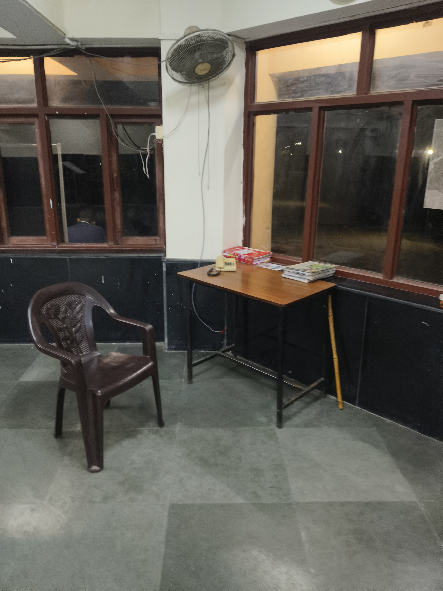
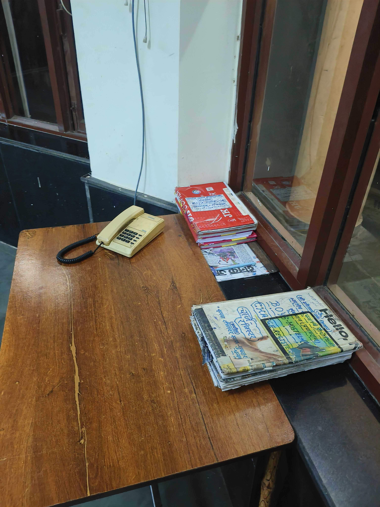

# BH-4 Guard Desk Fieldwork

## Location & Time
- Place: Boys Hostel 4 (BH-4) Ground Floor Guard Desk, IIIT Allahabad
- Date & Duration: Nov 20, 2026 (~20 minutes, around 7:00 PM - 7:20 PM)

## Timestamped Photos

## Conversation
- **Name:** Satyajit Mishra
- **Role:** Security Guard, BH-4
- **3 things he said:**
  1. He said everything is jumbled together in one register, you have to flip through manually to find specifics like cooler repairer visits.
  2. His shift goes from 2pm to 10pm.
  3. People do sometimes forget to sign before entry or write in a mix of hindi and english.
- **1 thing that surprised me:**
  - I was expecting separate books for visitors vs hostel residents but laundry, maintainance and other people all were bundled in the same book!

## How data.csv Was Collected
- I photographed Oct to Nov pages by asking the watchman, and removed names and phone numbers for privacy reasons while keeping the messy dates, blank rooms, and missing out-times intact.
